# Protocol Architecture & Flow Diagrams

This gallery compiles the formal Mermaid sequence diagrams, state-machine diagrams, and component interaction maps for Shade Protocol. Every diagram adheres to GitHub-compatible Mermaid syntax and models on-chain Soroban contract interactions, actors, and token transfers.

---

## Table of Contents

- [1. Component Architecture Diagram](#1-component-architecture-diagram)
- [2. Sequence Diagrams](#2-sequence-diagrams)
  - [2.1 Merchant Registration & Account Deployment](#21-merchant-registration--account-deployment)
  - [2.2 Invoice Creation & Payment with Fee Routing](#22-invoice-creation--payment-with-fee-routing)
  - [2.3 Partial Payment Settlement](#23-partial-payment-settlement)
  - [2.4 Refund Processing](#24-refund-processing)
  - [2.5 Fiat Invoice Resolution via Oracle](#25-fiat-invoice-resolution-via-oracle)
  - [2.6 Recurring Subscription Charge](#26-recurring-subscription-charge)
  - [2.7 Escrow Deposit & Milestone Release](#27-escrow-deposit--milestone-release)
  - [2.8 Ticket Purchase & Capped Resale](#28-ticket-purchase--capped-resale)
  - [2.9 Two-Step Contract Upgrade Flow](#29-two-step-contract-upgrade-flow)
- [3. State Transition Diagrams](#3-state-transition-diagrams)
  - [3.1 Invoice Status Lifecycle](#31-invoice-status-lifecycle)
  - [3.2 Subscription Status Lifecycle](#32-subscription-status-lifecycle)
  - [3.3 Escrow Status Lifecycle](#33-escrow-status-lifecycle)
  - [3.4 Merchant Withdrawal Request Status](#34-merchant-withdrawal-request-status)
  - [3.5 Ticket Token Lifecycle](#35-ticket-token-lifecycle)

---

## 1. Component Architecture Diagram

The diagram below illustrates the cross-contract invocation topography between the central `shade` payment hub and modular satellite contracts in the Soroban host environment.

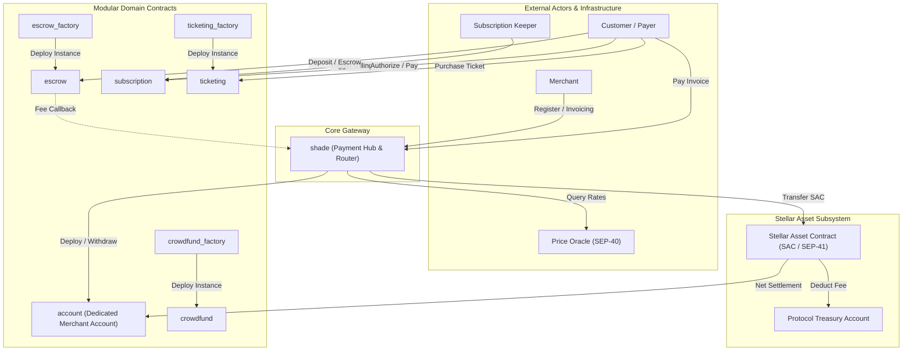

---

## 2. Sequence Diagrams

### 2.1 Merchant Registration & Account Deployment

Shows how a merchant registers on the hub, resulting in the deterministic deployment and binding of an isolated `account` contract.

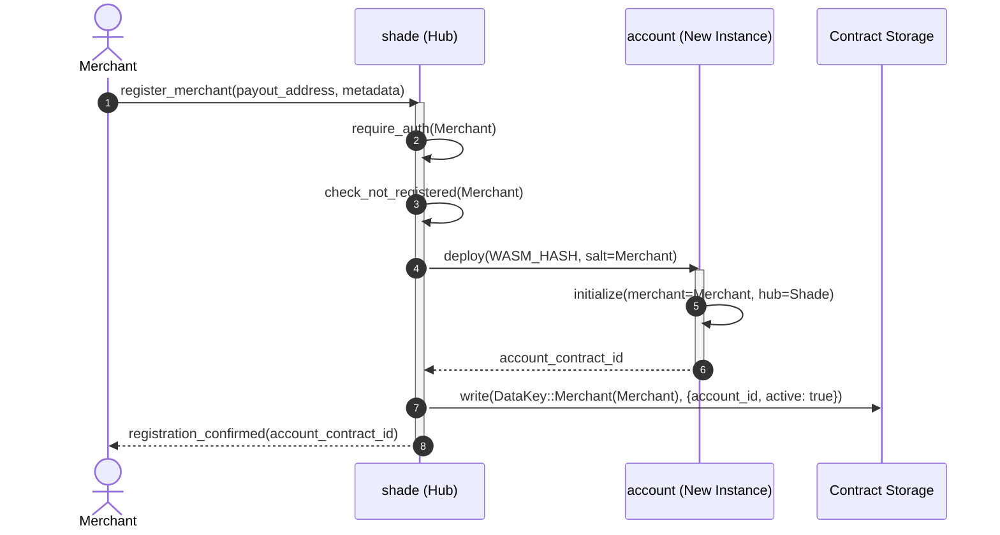

---

### 2.2 Invoice Creation & Payment with Fee Routing

Shows standard payment routing: token transfer authorization, fee deduction routed to the protocol treasury, and net settlement in the merchant's dedicated account.

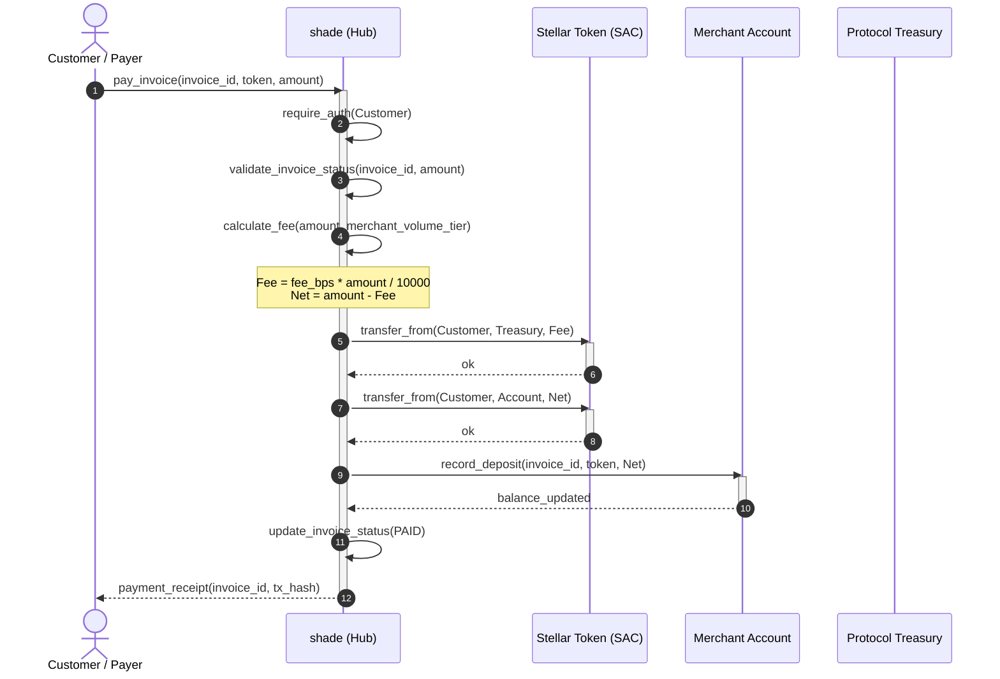

---

### 2.3 Partial Payment Settlement

Shows installment or partial invoice payments updating remaining balances without prematurely marking invoices fully paid.

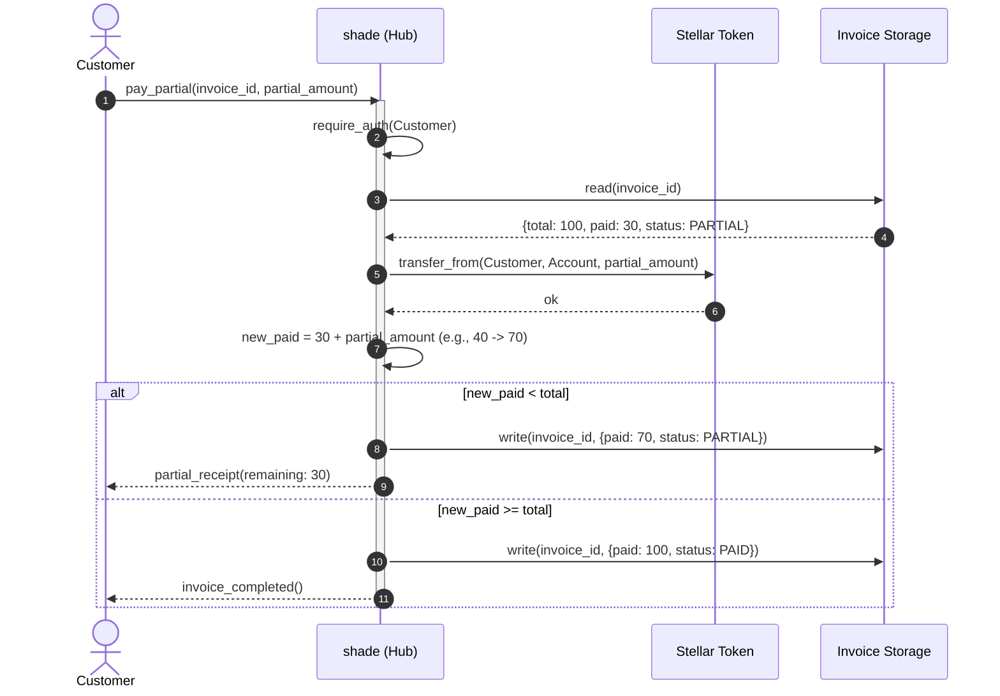

---

### 2.4 Refund Processing

Shows merchant-initiated refunds returning tokens back to the customer's wallet.

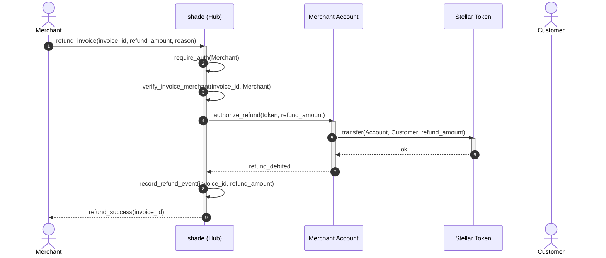

---

### 2.5 Fiat Invoice Resolution via Oracle

Illustrates how an invoice denominated in fiat (e.g., USD) dynamically resolves to accepted Stellar tokens using a SEP-40 price oracle feed.

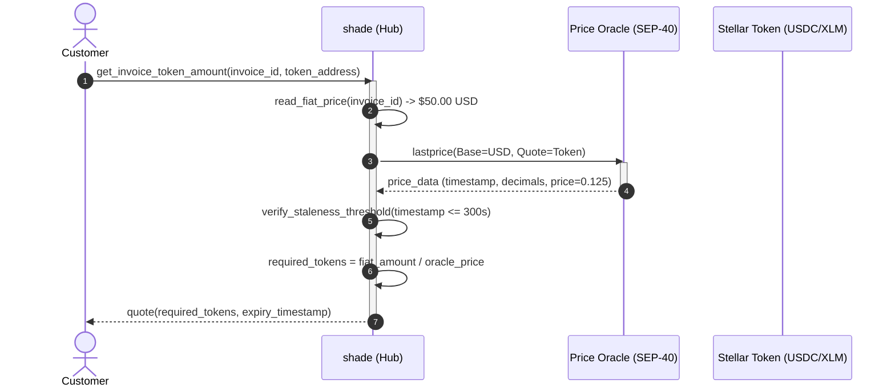

---

### 2.6 Recurring Subscription Charge

Models automated recurring subscription billing triggered by keepers using user pre-authorized allowances.

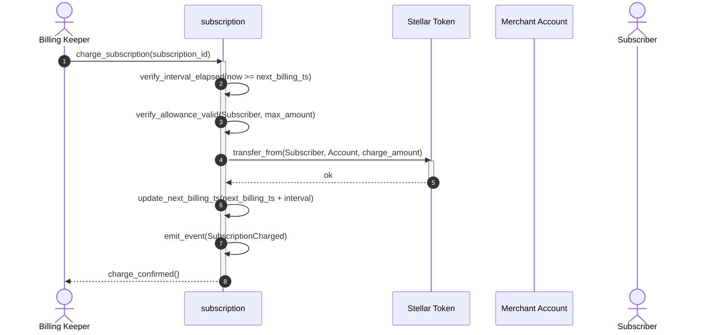

---

### 2.7 Escrow Deposit & Milestone Release

Shows the multi-party conditional escrow lifecycle from initial funding to milestone verification and dispute arbitration.

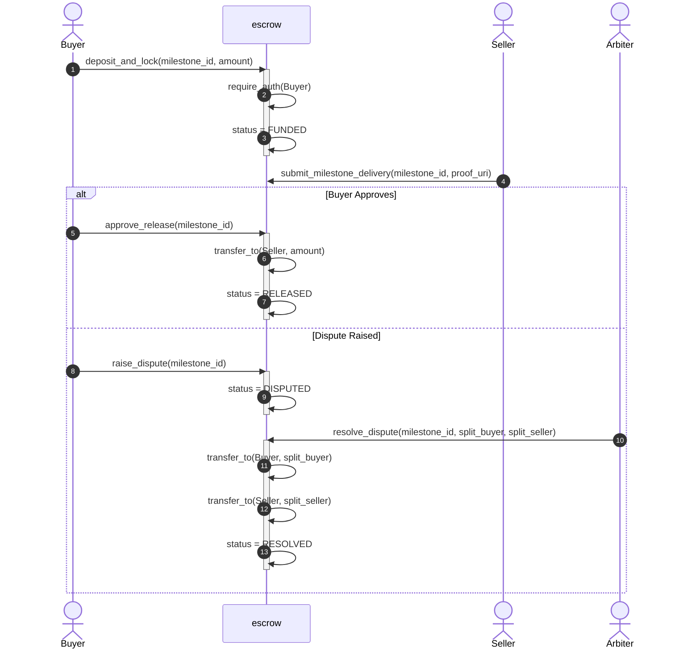

---

### 2.8 Ticket Purchase & Capped Resale

Illustrates anti-scalping logic enforcing hard resale price ceilings on secondary ticket transfers.

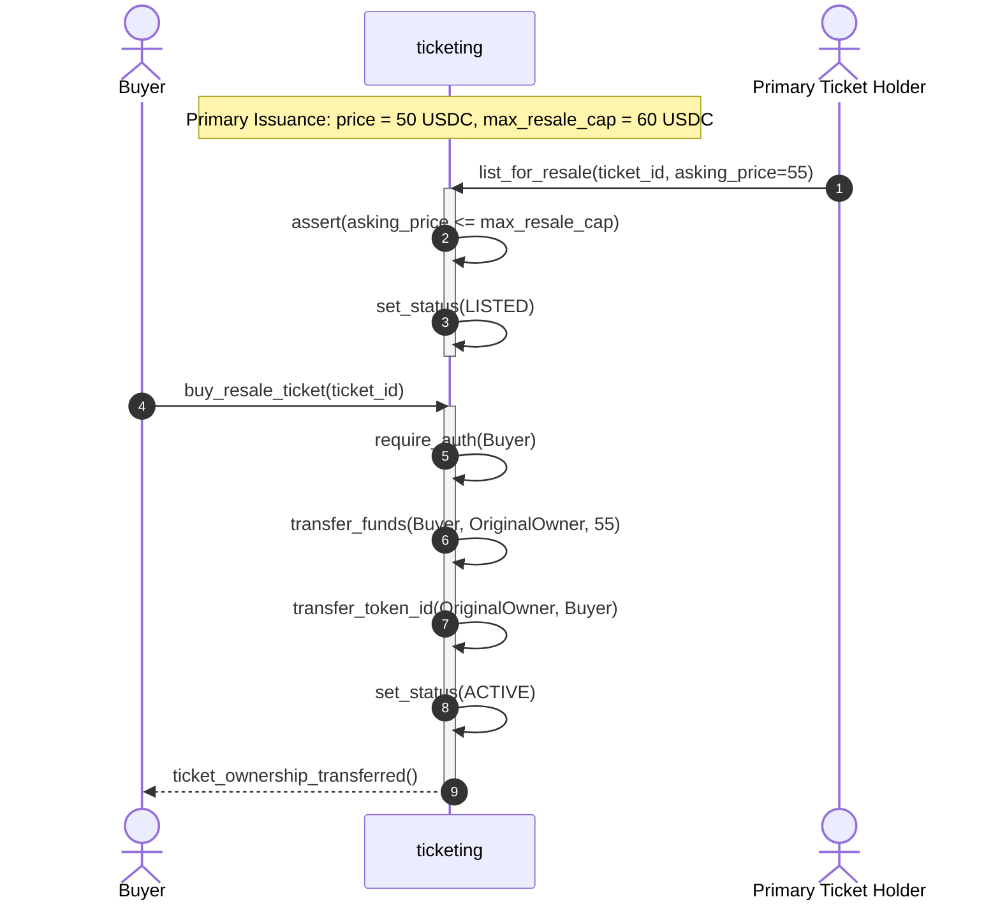

---

### 2.9 Two-Step Contract Upgrade Flow

Shows how audited WASM bytecode replaces existing contract logic while safeguarding persistent storage schemas.

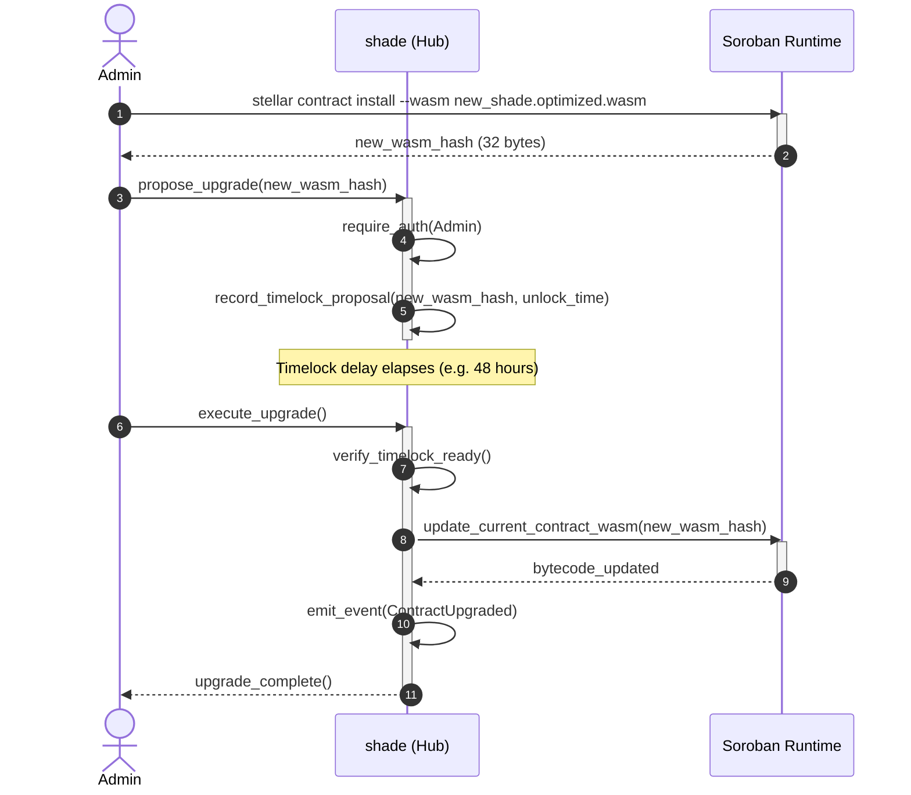

---

## 3. State Transition Diagrams

### 3.1 Invoice Status Lifecycle

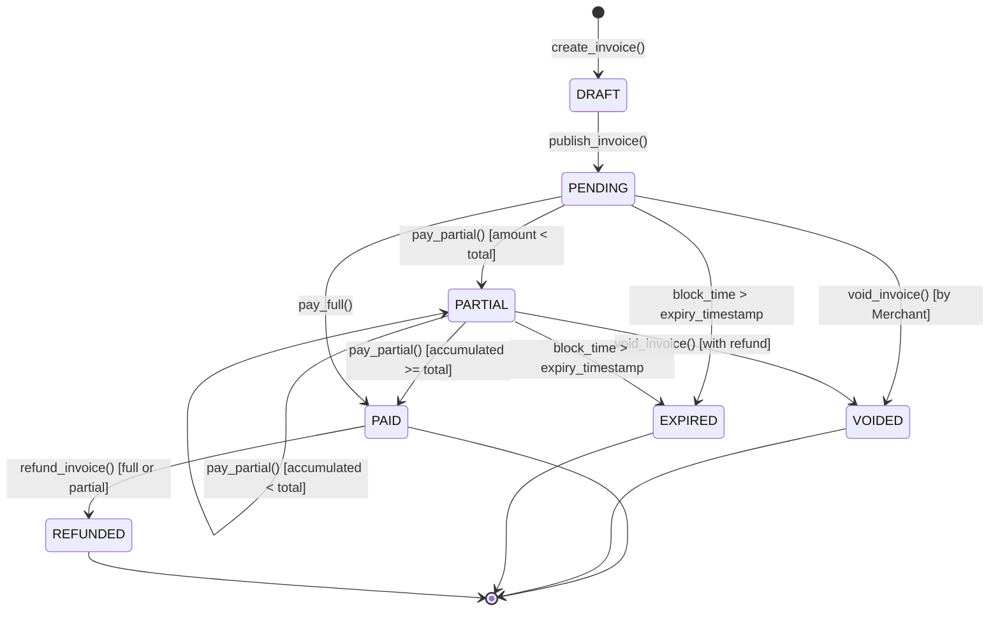

---

### 3.2 Subscription Status Lifecycle

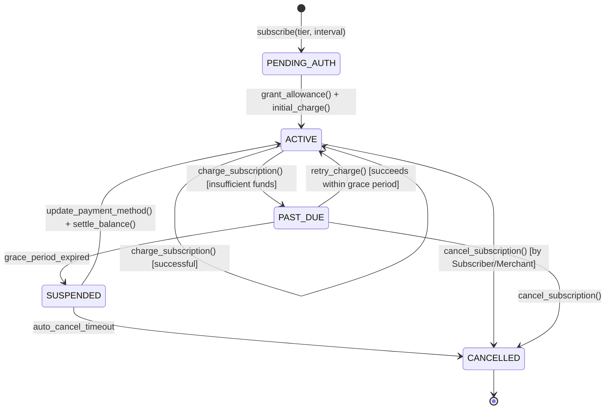

---

### 3.3 Escrow Status Lifecycle

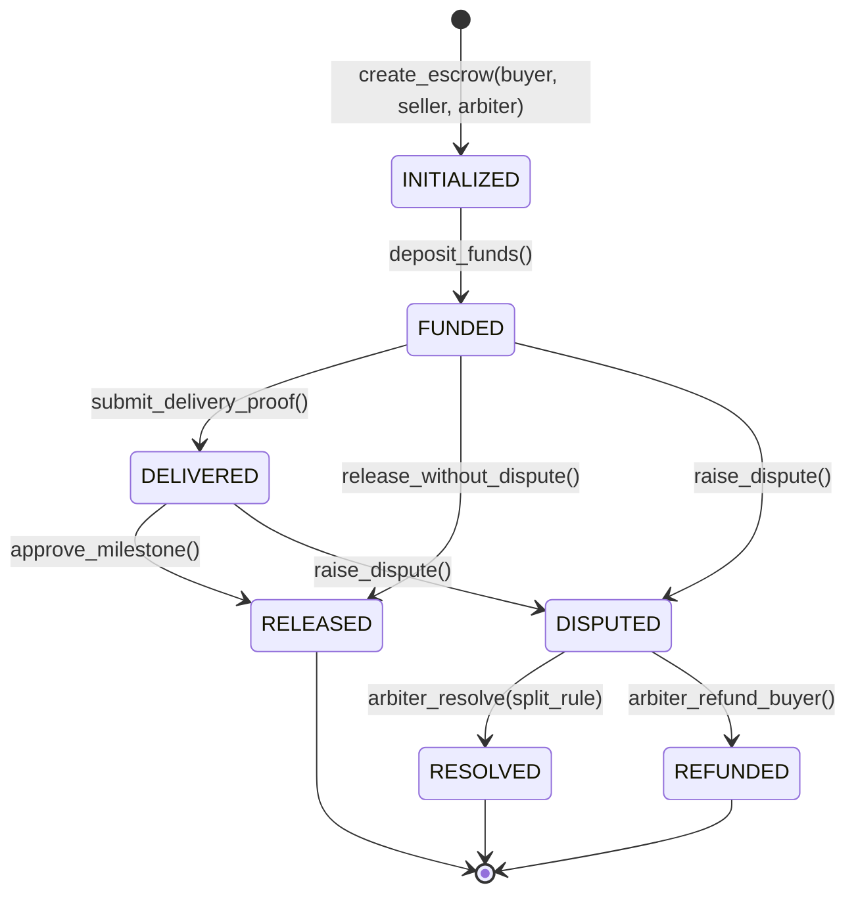

---

### 3.4 Merchant Withdrawal Request Status

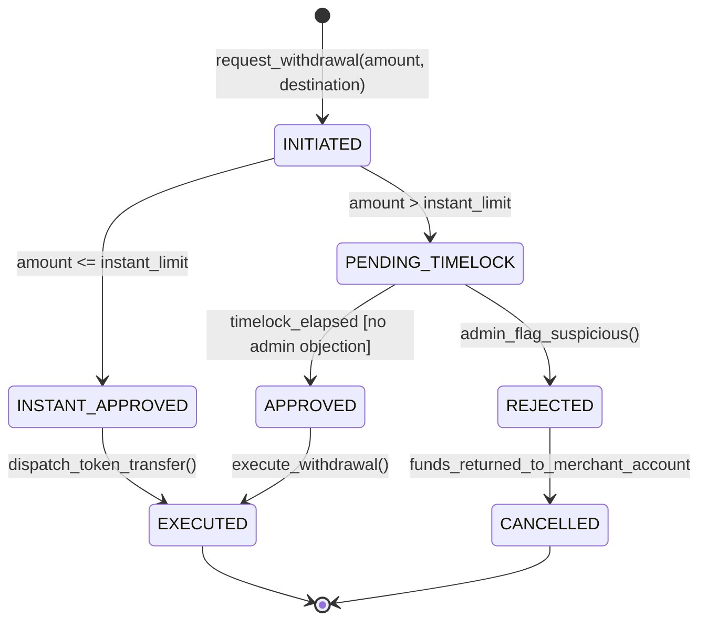

---

### 3.5 Ticket Token Lifecycle

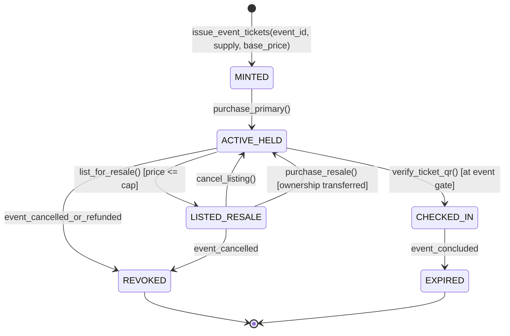
