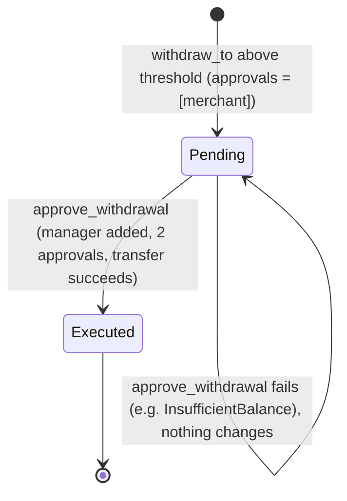

# Merchant account withdrawals, thresholds, and approval requests

Each merchant has a dedicated `account` contract that holds their funds. Money leaves it through `withdraw_to`, either immediately (at or below a configurable threshold) or through a two-party approval request (above it). This page describes both paths, the `WithdrawalRequest` record, and how restriction affects them. Source: [`contracts/account/src/account.rs`](../../contracts/account/src/account.rs) and [`interface.rs`](../../contracts/account/src/interface.rs).

## Why it exists

A compromised merchant key should not be able to drain an account in one transaction. The threshold lets a merchant move small amounts freely while requiring a second party, the account's `manager`, to sign off on large ones.

## Roles

| Role | Set by | Meaning |
|---|---|---|
| `merchant` | `initialize` | Owner of the account. Initiates withdrawals. |
| `manager` | `initialize` | Operator that configures the threshold, approves large withdrawals, and restricts or verifies the account. |

When the account is deployed by the Shade hub (`deploy_account` in [`account_factory.rs`](../../contracts/shade/src/components/account_factory.rs)), the **hub contract itself** is the `manager`.

> **Warning:** The hub contract does not expose wrappers for `set_withdrawal_threshold` or `approve_withdrawal`. For a hub-deployed account, those two calls need the manager's authorization, which only the hub contract can give, so there is currently no hub entry point to make them. The flow below applies as written to accounts whose `manager` is an address that can sign directly. The restriction path through the hub does exist, see [Restriction and verification](#restriction-and-verification).

## Functions and authorization

| Function | Who must authorize | Purpose |
|---|---|---|
| `withdraw_to(token, amount, recipient)` | `merchant` | Withdraw now, or create a `WithdrawalRequest` if above the threshold. |
| `set_withdrawal_threshold(threshold)` | `manager` | Set the immediate-withdrawal limit. `0` disables the approval path. |
| `get_withdrawal_threshold() -> i128` | None | Read the threshold. Returns `0` if never set. |
| `approve_withdrawal(request_id)` | `manager` | Approve a pending request and execute it. |
| `get_withdrawal_request(request_id) -> WithdrawalRequest` | None | Read a request. Panics (no typed error) if the ID does not exist. |

## The threshold rule

`withdraw_to` evaluates, in order:

1. `merchant.require_auth()`.
2. If the account is restricted, fail with `AccountRestricted`.
3. Read the threshold. If `threshold > 0 && amount > threshold`, create a request and **return without moving funds**.
4. Otherwise execute immediately.

| Threshold | Amount | Result |
|---|---|---|
| `0` (default) | any | Executes immediately. |
| `1_000` | `1_000` | Executes immediately (the comparison is strictly greater than). |
| `1_000` | `1_001` | Creates a `WithdrawalRequest`. |

The threshold is compared per call, per token, in raw base units. It is not a daily or cumulative limit, and it is not scaled per token: a threshold of `1_000` means 1,000 base units of whatever token is withdrawn. Several withdrawals each at or below the threshold all execute immediately.

Immediate execution checks that the account balance for `token` is at least `amount` (otherwise `InsufficientBalance`), transfers to `recipient`, updates the token's `WithdrawalAnalytics`, and emits a withdrawal event. Creating a request does **not** check the balance and does not reserve funds. The balance is checked when the request executes.

## `WithdrawalRequest`

| Field | Type | Meaning |
|---|---|---|
| `id` | `u64` | Sequential ID starting at 1, per account. |
| `token` | `Address` | Token to withdraw. |
| `amount` | `i128` | Amount in base units. |
| `recipient` | `Address` | Destination. |
| `approvals` | `Vec<Address>` | Addresses that approved. Starts as `[merchant]`. |
| `status` | `WithdrawalStatus` | `Pending`, `Approved`, or `Executed`. |

### Status transitions



`WithdrawalStatus::Approved` exists in the enum, but the current implementation never assigns it. The merchant's initiating call counts as the first approval; when the manager approves, `approvals` reaches two and the request moves straight from `Pending` to `Executed` in the same call. A request is only ever observed as `Pending` or `Executed`.

`approve_withdrawal(request_id)`:

1. `manager.require_auth()`.
2. Fail with `InvoiceNotFound` (code 6) if the ID is unknown.
3. Fail with `InvalidInvoiceStatus` (code 7) if the request is not `Pending`, so a request executes only once.
4. Add the manager to `approvals` if absent.
5. If `approvals.len() >= 2`, set status `Executed` and transfer. An insufficient balance reverts the whole call with `InsufficientBalance` and the request stays `Pending`.

> **Note:** If the `merchant` and `manager` are the same address, the manager is already in `approvals`, the count stays at 1, and the request can never execute. Keep them distinct.

Two behaviours to be aware of:

- **No cancel or reject.** There is no function to cancel a pending request. It stays `Pending` until approved.
- **No restriction check at approval.** `approve_withdrawal` does not check the restricted flag. A request created before the account was restricted can still be executed afterwards by the manager. The check is only in `withdraw_to` (and `refund`).

## Restriction and verification

| Flag | Set by | Read by | Effect on withdrawals |
|---|---|---|---|
| Restricted | `restrict_account(status)` (manager) | `is_restricted_account()` | While `true`, `withdraw_to` and `refund` fail with `AccountRestricted` (code 5). Reads and `approve_withdrawal` are unaffected. |
| Verified | `verify_account()` (manager) | `is_verified_account()` | **None.** The flag is stored and exposed for callers to read, but no withdrawal code consults it. |

Restriction is a toggle: `restrict_account(false)` lifts it.

### How the hub reaches the account

`restrict_merchant_account(caller, merchant_address, status)` on the hub ([`merchant.rs`](../../contracts/shade/src/components/merchant.rs)):

1. Requires `caller` auth and the hub `Admin` or `Manager` role, otherwise `NotAuthorized`.
2. Looks up the merchant ID, failing with `MerchantNotFound` if unknown.
3. Resolves the account address (the merchant's registered account, or the merchant address if none is set).
4. Calls `restrict_account(status)` on that account. The hub is the account's `manager`, so its auth satisfies the check.
5. Emits an account-restricted event on the hub.

## Reading state for reconciliation

| Function | Returns |
|---|---|
| `get_balance(token)` | Current token balance of the account (live, from the token contract). |
| `get_balances()` | `Vec<TokenBalance { token, balance }>` for every token registered with `add_token`. Untracked tokens are not listed. |
| `get_withdrawal_analytics(token)` | `WithdrawalAnalytics { token, total_withdrawn, withdrawal_count, last_withdrawn_at }`, zeroed if there have been no withdrawals. |

Analytics are updated only when a transfer executes, whether immediate or via approval. Pending requests do not appear in analytics. To reconcile, compare `total_withdrawn` and `withdrawal_count` with the withdrawal events, and list requests by reading `get_withdrawal_request` for IDs `1..n`.

## Errors

| Error | Code | Where |
|---|---|---|
| `NotInitialized` | 2 | Account not initialized. |
| `InsufficientBalance` | 4 | Execution with `amount` above the account balance. |
| `AccountRestricted` | 5 | `withdraw_to` or `refund` while restricted. |
| `InvoiceNotFound` | 6 | `approve_withdrawal` with an unknown ID. (Name inherited from the invoice flow; it means "request not found" here.) |
| `InvalidInvoiceStatus` | 7 | `approve_withdrawal` on a request that is not `Pending`. |

A missing authorization (wrong signer) fails at the host level with an auth error rather than a contract error.

## Worked example

Account with `merchant = M`, `manager = G`, token `T`, balance 10,000, recipient `R`.

```text
G: set_withdrawal_threshold(1_000)
M: withdraw_to(T, 800, R)      // <= threshold: executes now
                               //   balance 9_200, analytics: total 800, count 1
M: withdraw_to(T, 5_000, R)    // > threshold: creates request id = 1
                               //   balance unchanged 9_200
                               //   request: status Pending, approvals [M]
anyone: get_withdrawal_request(1)
G: approve_withdrawal(1)       // approvals [M, G] -> Executed, transfer 5_000
                               //   balance 4_200, analytics: total 5_800, count 2
G: approve_withdrawal(1)       // fails: InvalidInvoiceStatus (already Executed)
```

If `G` had called `restrict_account(true)` before the second `withdraw_to`, that call would fail with `AccountRestricted` and no request would be created.

[`contracts/account/src/tests/test_withdrawal.rs`](../../contracts/account/src/tests/test_withdrawal.rs) covers the direct path, merchant auth, insufficient balance, restriction, and analytics. At the time of writing it has no tests for the threshold or approval path, so the transitions above are derived from `account.rs`.

## Related pages

- [Merchants](./merchants.md)
- [Auto-withdrawal and merchant settlement](./auto-withdrawal.md)
- [Account contract reference](../contracts/account.md)
