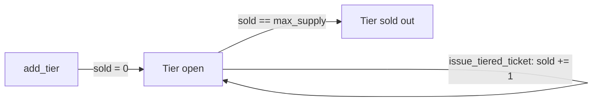

# Ticket tiers and tiered issuance

Tiers let an event organizer split one event into priced categories (for example General Admission and VIP), each with its own price label and supply cap. They are implemented in the standalone `ticketing` contract (`contracts/ticketing/`), not in the Shade hub's built-in ticketing feature.

> **Note:** `ticketing` is a separate system from the hub ticketing described in [Event ticketing, dynamic pricing, and resale](./event-ticketing.md). The two share no code or storage. See the [ticketing contract reference](../contracts/ticketing.md) for the full interface.

## Why it exists

A flat `issue_ticket` call treats every seat the same. Organizers who sell different seat classes need per-class supply limits that cannot oversell one class by consuming another class's seats, and a stored price that off-chain UIs can display consistently.

## How it works

1. The organizer creates an event with `create_event`, optionally with an overall `max_capacity`.
2. The organizer calls `add_tier` once per category. Each call returns a new global, sequential `tier_id` (starting at 1, shared across all events) and emits a `TierCreatedEvent`.
3. For each attendee, the organizer calls `issue_tiered_ticket` with the chosen `tier_id`. The contract mints a `Ticket` whose `tier_id` is `Some(tier_id)` and increments that tier's `sold` counter.
4. Clients read configuration and progress with `get_tier` and `get_event_tiers`.

Only the event's organizer can add tiers or issue tiered tickets. Both functions call `organizer.require_auth()` and reject any other address with `NotAuthorized`.



## Relevant types and storage

### `Tier`

| Field | Type | Meaning |
|---|---|---|
| `tier_id` | `u64` | Global sequential ID, assigned by `add_tier`. |
| `event_id` | `u64` | The event this tier belongs to. |
| `name` | `String` | Display name, for example `"VIP"`. Not required to be unique. |
| `price` | `i128` | Price per ticket in token base units. Must be `>= 0`; `0` is allowed for free admission. Informational only, see [Tier prices and other pricing features](#tier-prices-and-other-pricing-features). |
| `max_supply` | `u64` | Maximum tickets this tier may issue. Must be `> 0`. |
| `sold` | `u64` | Tickets issued from this tier so far. Starts at `0`. |

`Ticket.tier_id` is `Option<u64>`: `Some(tier_id)` for tickets from `issue_tiered_ticket`, `None` for tickets from the legacy `issue_ticket`.

Storage keys (persistent): `Tier(tier_id)`, `TierCount`, and `EventTiers(event_id)` (the list of tier IDs for an event, in creation order).

## Relevant functions

| Function | Auth | Purpose |
|---|---|---|
| `add_tier(organizer, event_id, name, price, max_supply) -> u64` | Event organizer | Create a tier and return its `tier_id`. |
| `issue_tiered_ticket(organizer, event_id, holder, qr_hash, tier_id) -> u64` | Event organizer | Mint a ticket from a tier and return its `ticket_id`. |
| `get_tier(tier_id) -> Tier` | None | Read one tier. Panics with `TierNotFound` if missing. |
| `get_event_tiers(event_id) -> Vec<Tier>` | None | Read all tiers of an event in creation order. Returns an empty list if the event has none or does not exist. |

All four are defined in [`contracts/ticketing/src/lib.rs`](../../contracts/ticketing/src/lib.rs).

## Supply and capacity invariants

For every event with `max_capacity = Some(cap)` and tiers `t1 … tn`:

```
sum(ti.max_supply) <= cap          (enforced by add_tier)
ti.sold <= ti.max_supply           (enforced by issue_tiered_ticket)
active tickets of the event <= cap (enforced by issue_tiered_ticket)
```

- `add_tier` rejects a tier if `sum(existing max_supply) + new max_supply > cap`. This commits tier supply at configuration time so an organizer cannot promise more seats than exist.
- When the event has no `max_capacity` (`None`), tier supplies are unbounded and independent.
- `issue_tiered_ticket` checks the tier first (`sold >= max_supply` fails), then the event's active ticket count against `max_capacity`. The event-level count also includes tickets from `issue_ticket`, which has no tier, so untiered issuance can exhaust event capacity before a tier is sold out. In that case issuance fails with `EventAtCapacity` even though the tier has seats left.
- A tier sells out independently of the event: the third ticket of a 2-seat VIP tier fails even if the event has plenty of room.
- `sold` only ever increases. `refund_ticket` does not decrement it (see below).

## Tier prices and other pricing features

`Tier.price` is metadata. `issue_tiered_ticket` does not collect payment and does not check any amount against `price`; settlement happens outside the call. The tier price interacts with other features as follows:

- **Dynamic pricing.** The early-bird and late-markup pricing in [Event ticketing](./event-ticketing.md) belongs to the Shade hub and has no counterpart in the `ticketing` contract. A tier's `price` is fixed at creation and there is no function to change it. To change prices, add a new tier.
- **Resale caps.** `set_resale_config` stores only a `payment_token` and a `royalty_bps` per event. `resell_ticket` accepts any `sale_price > 0`, so there is no price ceiling or floor, and it does not compare the sale price to the tier price. The royalty is a share of the resale price paid to the organizer. `Ticket.tier_id` does not change on resale.
- **Refunds.** `refund_ticket` marks the ticket `refunded`, removes it from the event's active list (freeing event capacity), and assigns the first waitlist entry a new ticket. It moves no tokens and does not decrement `Tier.sold`. A refunded ticket keeps consuming its tier's `max_supply`.

> **Warning:** Because `sold` is never decremented, a tier whose tickets are refunded can show as sold out while the event still has unused capacity. An organizer who needs those seats back must add a new tier.

## Errors

| Error | Code | Raised when |
|---|---|---|
| `TierNotFound` | 9 | `issue_tiered_ticket` or `get_tier` gets a `tier_id` that was never created. |
| `TierAtCapacity` | 10 | `issue_tiered_ticket` is called when `sold >= max_supply` (tier sold out), or `add_tier` would push combined tier supply above the event's `max_capacity`. |
| `InvalidTierSupply` | 11 | `add_tier` called with `max_supply == 0`. |
| `InvalidTierPrice` | 12 | `add_tier` called with `price < 0`. |
| `TierEventMismatch` | 13 | `issue_tiered_ticket` called with a `tier_id` that belongs to a different event than `event_id`. |
| `EventNotFound` | 1 | `event_id` does not exist. |
| `NotAuthorized` | 3 | Caller is not the event's organizer. |
| `EventAtCapacity` | 4 | The event's active ticket count has reached `max_capacity`. |
| `DuplicateQRHash` | 5 | `qr_hash` is already used by another ticket. |

`InvalidTierSupply` and `InvalidTierPrice` are checked before the event is loaded, so they take precedence over `EventNotFound`.

## Example: three tiers

This follows the patterns in [`contracts/ticketing/src/test_tiers.rs`](../../contracts/ticketing/src/test_tiers.rs), which covers sequential IDs, independent `sold` counters, tier sell-out, mismatched events, and the capacity check. The scenario below is illustrative; the test file itself uses two tiers.

An event with `max_capacity = 200` gets three tiers:

```rust
let event_id = client.create_event(&organizer, &name, &desc, &1_000, &2_000, &Some(200));

let vip  = client.add_tier(&organizer, &event_id, &String::from_str(&env, "VIP"),     &500_i128, &20_u64);  // tier 1
let ga   = client.add_tier(&organizer, &event_id, &String::from_str(&env, "General"), &100_i128, &150_u64); // tier 2
let free = client.add_tier(&organizer, &event_id, &String::from_str(&env, "Free"),    &0_i128,   &30_u64);  // tier 3
// 20 + 150 + 30 = 200 <= 200, so all three succeed.

client.issue_tiered_ticket(&organizer, &event_id, &alice, &qr(1), &vip);
client.issue_tiered_ticket(&organizer, &event_id, &bob,   &qr(2), &ga);
client.issue_tiered_ticket(&organizer, &event_id, &carol, &qr(3), &free);

assert_eq!(client.get_tier(&vip).sold, 1);
assert_eq!(client.get_tier(&ga).sold, 1);
assert_eq!(client.get_tier(&free).sold, 1);
assert_eq!(client.get_event_tiers(&event_id).len(), 3);
```

Adding a fourth tier with `max_supply >= 1` fails with `TierAtCapacity` because the supply is already fully committed. Issuing a 21st VIP ticket fails with `TierAtCapacity` for the same reason, even if other tiers have unsold seats.

## Related pages

- [Ticketing contract reference](../contracts/ticketing.md)
- [Event ticketing, dynamic pricing, and resale](./event-ticketing.md)
