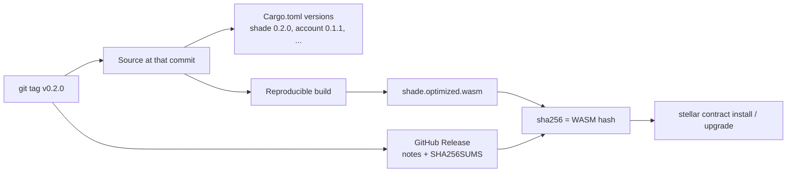

# Runbook: Releasing the contracts

How to version, tag, build, record, and publish a release of the Shade Protocol contracts, so that integrators and operators can map any deployed WASM hash back to a git tag, a changelog entry, and a set of release notes. Use this runbook when you are the release owner cutting a release; for putting a release on a network, continue with the [Deployment Runbook](deployment.md) or the [Contract Upgrade Runbook](upgrade-runbook.md).

> **Warning:** A published WASM hash is permanent. Once a release's artifacts have been installed on mainnet, you cannot change what that hash means. If you find a mistake after publishing, ship a new patch release; never move a tag or replace a release asset.

## Why releases need a record

A Soroban contract's identity on chain is its WASM hash — the SHA-256 of the installed bytes, which `stellar contract install` returns and `upgrade` takes as its only argument. Nothing in the contract state carries a version: every crate's `Cargo.toml` says `version = "0.0.0"` and that number is never read on chain (see [Upgradeability § Versioning](../architecture/upgradeability.md#versioning-and-identifying-a-deployed-build)).

That makes the release record the **only** bridge between a hash on chain and a description of what the code does. The record has four parts, and each points at the next:

| Part | Where it lives | Answers |
|---|---|---|
| Git tag | `vMAJOR.MINOR.PATCH` on the repository | Which exact source produced this release? |
| Changelog entry | [`CHANGELOG.md`](../../CHANGELOG.md) | What changed, and is any of it breaking? |
| WASM hashes | `SHA256SUMS` and the release notes table | Which hash is which contract at this release? |
| GitHub Release | The repository's Releases page | Where do I download the artifacts and read the notes? |

## Versioning scheme

### Release versions

A **release** is a coordinated set of contract builds cut from one commit. It carries one version, `MAJOR.MINOR.PATCH`, written as a git tag with a leading `v` — `v0.1.0`.

The release version moves according to the **most severe** change in any contract in the release:

| Phase | Bump `MAJOR` | Bump `MINOR` | Bump `PATCH` |
|---|---|---|---|
| Before 1.0 (`0.y.z`) | Never — stay on `0` until the interface is declared stable | Any [breaking change](#breaking-changes-for-integrators), or any new functionality | Bug fixes, docs, and internal changes with no interface or behavior change |
| From 1.0 | Any breaking change | New backward-compatible functionality | Backward-compatible fixes |

Every breaking change is called out regardless of which number it bumps. Before 1.0, the number alone does not tell an integrator whether to worry; the `**BREAKING:**` marker does.

### Contract versions

Each contract crate keeps its own [SemVer](https://semver.org/) number in its `Cargo.toml`: `shade`, `account`, `escrow`, `escrow_factory`, `subscription`, `ticketing`, `ticketing_factory`, `crowdfund`, and `crowdfund_factory`. The rules:

- **Bump a crate only when its WASM changes.** A release can include `shade 0.3.0` and `account 0.1.0` unchanged.
- **Bump the dependents too.** `shade` depends on `account` by path, so a change to the `account` crate's source changes the `shade` WASM and requires at least a patch bump of `shade`.
- **Apply the same MAJOR/MINOR/PATCH rules** from the table above to each crate on its own.
- **Bump in the release PR**, not in feature PRs. Feature PRs only add changelog lines under `## [Unreleased]`.

The release version is then the highest bump among the crates that changed. The first tagged release is `v0.1.0`, with every crate that ships in it set to `0.1.0`.

### How versions map to hashes and tags



The tag fixes the source, the source fixes the crate versions, the reproducible build fixes the bytes, and the bytes fix the hash. To go the other way — from a hash found on chain to a version — search the release notes tables and `SHA256SUMS` files for it.

> **Note:** A WASM hash identifies an exact build, so rebuilding the same tag with a different Rust or Stellar CLI version can produce a different hash. That is why the release notes record the toolchain and why the build step below requires a matching hash from an independent second build.

## Breaking changes for integrators

A change is **breaking** when an integrator who changes nothing — no code, no generated bindings, no operational process — can stop working or start misbehaving after upgrading. Integrators here include backend services, indexers, frontends built on generated bindings, other contracts that call Shade, and operators.

Check every pull request against this table. If any row in the **Breaking** column applies, the change is breaking.

| Area | Breaking | Not breaking |
|---|---|---|
| **Interface signatures** | Removing or renaming a public function; adding, removing, reordering, or retyping a parameter; changing a return type; changing a field of a `#[contracttype]` that appears in a signature; making a function require authorization from a different or an additional address | Adding a new function; adding a variant to the end of a `#[repr(u32)]` enum that callers only read |
| **Event shapes** | Renaming an event (its topic is derived from the struct name in snake case); removing, renaming, or retyping a field; moving an event to a different emitting contract; no longer emitting an event | Adding a new event; adding a field to an existing event, because the payload is a map keyed by field name |
| **Error codes** | Renumbering, removing, or repurposing a code; raising an existing code in a new situation on a path that used to succeed; moving a variant to a different range | Adding a new variant with a new code on a new code path |
| **Storage layout** | Renaming, retyping, or moving a key-enum variant (`DataKey` and its siblings); renumbering a `#[repr(u32)]` enum variant; adding, removing, or renaming a field of a persisted struct without a migration in the same WASM | Adding a new key-enum variant; adding a new enum variant with a new, higher number |
| **Behavior and economics** | Changing how fees are computed or rounded, the fee time-lock, the refund window, invoice-expiry semantics, or accepted-token rules in a way that changes outcomes for an unchanged call | Gas or resource-cost changes that stay inside normal limits; tighter validation that only rejects calls that were already invalid |
| **Deployment dependencies** | Changing how a contract is initialized (`initialize` arguments); changing the `account` interface that `shade` calls | Internal refactors with identical external behavior |

Storage-layout rows are breaking even though no integrator calls storage directly: a layout change can make an upgraded contract misread existing state. Treat them with the [Upgrade Runbook § Storage compatibility](upgrade-runbook.md#storage-compatibility) checks.

### What a breaking change requires

A pull request that makes a breaking change must:

1. **Tick "Breaking change"** in the pull request template's *Type of Change* section.
2. **Add a changelog entry** under `## [Unreleased]`, prefixed `**BREAKING:**`, that says what changed and what an integrator must do:

   ```markdown
   ### Changed

   - **BREAKING: shade:** `create_invoice` now takes `expires_at: Option<u64>` as its last parameter.
     Regenerate bindings and pass `None` to keep the old behavior.
   ```

3. **Update the reference docs** in the same PR — see [CONTRIBUTING.md § Keeping reference docs in sync](../../CONTRIBUTING.md#keeping-reference-docs-in-sync).
4. **Bump accordingly** at release time: `MINOR` before 1.0, `MAJOR` from 1.0.
5. **Appear under "Breaking changes"** at the top of the release notes, with the migration steps copied from the changelog.

Reviewers should block a pull request that matches a **Breaking** row but is not marked.

## Preconditions

- Write access to the repository, including permission to push tags and create GitHub Releases.
- A clean checkout of `main` at the commit you intend to release, with every pull request for the release merged.
- Rust, the WASM target, and Stellar CLI installed at the versions in [Prerequisites](../getting-started/prerequisites.md). Record the exact versions; you will paste them into the release notes.
- `gh` (the GitHub CLI), authenticated, if you publish from the command line.
- CI green on the commit being released.

## Procedure

### 1. Choose the version and update the changelog

1. List the contracts whose source changed since the last tag (`git diff --stat vPREVIOUS -- contracts/`), and add `account` to that list's dependents as described under [Contract versions](#contract-versions).
2. Pick the release version from the most severe change.
3. In [`CHANGELOG.md`](../../CHANGELOG.md), rename `## [Unreleased]` to `## [X.Y.Z] - YYYY-MM-DD`, then add a fresh empty `## [Unreleased]` above it. Group entries under `### Added`, `### Changed`, `### Deprecated`, `### Removed`, `### Fixed`, and `### Security`, and move any `**BREAKING:**` entries to the top of their group.
4. Add a compare link at the bottom of the file for the new version, if the file has a link section.

### 2. Bump the crate versions

Set `version` in each changed crate's `Cargo.toml`, then refresh the lockfile without changing any dependency:

```bash
cargo update --workspace
git diff Cargo.lock
```

`Cargo.lock` must change only in the `[[package]]` entries for the crates you bumped. If it changes anything else, restore it with `git checkout -- Cargo.lock` and bump the versions again — see [Troubleshooting § Stale or conflicting `Cargo.lock`](../getting-started/troubleshooting.md#4-stale-or-conflicting-cargolock).

### 3. Verify before tagging

```bash
cargo fmt --all -- --check
cargo clippy --workspace --all-features -- -D warnings
cargo test --workspace --all-features
```

If this release changes a storage layout or an interface, also complete the [Upgrade Runbook pre-flight](upgrade-runbook.md#pre-flight) against a testnet deployment. Merge the release pull request (changelog and version bumps) to `main`.

### 4. Tag the release

Tag the merge commit. Use an annotated tag, signed if your team has signing keys:

```bash
git checkout main
git pull --ff-only
git tag -a v0.1.0 -m "Shade Protocol v0.1.0"
git push origin v0.1.0
```

Never move or delete a tag after you have pushed it.

### 5. Build reproducible WASMs

Build from the tag, in a clean checkout, with the lockfile enforced:

```bash
git clone https://github.com/ShadeProtocol/shade-stellar-contract.git release-build
cd release-build
git checkout v0.1.0

RUSTFLAGS="--remap-path-prefix=$PWD=/build --remap-path-prefix=$HOME/.cargo=/cargo" \
  cargo build --locked --target wasm32-unknown-unknown --release \
    -p shade -p account -p escrow -p escrow_factory -p subscription \
    -p ticketing -p ticketing_factory -p crowdfund -p crowdfund_factory

for c in shade account escrow escrow_factory subscription ticketing ticketing_factory crowdfund crowdfund_factory; do
  stellar contract optimize --wasm "target/wasm32-unknown-unknown/release/$c.wasm"
done
```

Why each part matters:

- **`--locked`** fails the build if `Cargo.lock` would change, so dependencies are exactly those reviewed.
- **`--remap-path-prefix`** removes your machine's directory layout from the WASM. Panic messages embed source paths, so without it two people building in different directories get different bytes.
- **The plain `release` profile** is the one deployments use; never ship a `release-with-logs` build. See [Building the Contracts](../getting-started/building.md#release-profile-settings).
- **`stellar contract optimize`** produces the `.optimized.wasm` file you hash and deploy. Hash the optimized file, never the plain one.

Now prove reproducibility: a second person, or a CI job, builds the same tag on another machine using the same commands, and the two sets of hashes must match:

```bash
sha256sum target/wasm32-unknown-unknown/release/*.optimized.wasm | sort -k2 > SHA256SUMS
cat SHA256SUMS
```

If the hashes differ, do not publish. The usual causes are a different Rust or Stellar CLI version, a different `--remap-path-prefix`, or a dirty checkout. Align the environments and rebuild.

> **Note:** This repository does not pin a toolchain with a `rust-toolchain.toml`, and CI uses the `stable` channel, so "the same toolchain" depends on your recording the exact `rustc --version` in the release notes. Pinning the toolchain, or building inside a pinned container image, would make this step stronger and is worth raising as its own issue.

### 6. Record the hashes

For each contract, record the SHA-256 of its optimized WASM. That value is the WASM hash the network will report after `stellar contract install`. Keep `SHA256SUMS` as a release asset and put the same values in the release notes table.

To confirm that a hash is what the network computes, install the WASM on testnet and compare:

```bash
stellar contract install \
  --wasm target/wasm32-unknown-unknown/release/shade.optimized.wasm \
  --source-account default --network testnet
# prints the WASM hash; it must equal the shade line in SHA256SUMS
```

### 7. Write the release notes

Copy the changelog section for the version and add the build record. Use this template:

````markdown
## Shade Protocol v0.1.0

### Breaking changes

<!-- Copy each **BREAKING:** changelog entry with its migration steps, or write "None." -->

### What's changed

<!-- The changelog sections for this version, grouped by contract. -->

### Contracts

| Contract | Crate version | WASM SHA-256 |
|---|---|---|
| shade | 0.1.0 | `…` |
| account | 0.1.0 | `…` |
| escrow | 0.1.0 | `…` |
| escrow_factory | 0.1.0 | `…` |
| subscription | 0.1.0 | `…` |
| ticketing | 0.1.0 | `…` |
| ticketing_factory | 0.1.0 | `…` |
| crowdfund | 0.1.0 | `…` |
| crowdfund_factory | 0.1.0 | `…` |

### Build record

- Commit: `<full SHA of the tag>`
- Toolchain: Rust `<rustc --version>`, Stellar CLI `<stellar --version>`, soroban-sdk `<version from Cargo.lock>`
- Build command: see [Releases runbook](docs/operations/releases.md#5-build-reproducible-wasms)
- Independently reproduced by: `<name or CI run>`

### Upgrading

<!-- For operators: which contracts need upgrading, in what order, and any storage or initialization steps. Link the Upgrade Runbook. -->
````

State clearly in "Upgrading" whether the release changes a storage layout. If it does, say whether a migration ships in the same WASM.

### 8. Publish the GitHub Release

Create the release from the tag and attach the optimized WASMs and checksums:

```bash
gh release create v0.1.0 \
  --title "Shade Protocol v0.1.0" \
  --notes-file RELEASE_NOTES.md \
  --verify-tag \
  target/wasm32-unknown-unknown/release/*.optimized.wasm \
  SHA256SUMS
```

`--verify-tag` aborts if the tag does not already exist on the remote. Mark a pre-release with `--prerelease`.

### 9. Announce and hand off

- Link the release in the project's usual announcement channels, and name every breaking change in the message.
- Tell operators which runbook applies: [Deployment](deployment.md) for a new deployment, [Upgrade](upgrade-runbook.md) for an existing one.
- After any mainnet deployment of this release, record the contract IDs against the release using the [artifact recording template](deployment.md#artifact-recording).

## Verification

A release is complete when all of these are true:

- [ ] `git tag --list 'v0.1.0'` shows the tag, and `git show v0.1.0` points at the intended commit.
- [ ] `CHANGELOG.md` has a dated section for the version and a fresh `## [Unreleased]` above it.
- [ ] Every changed crate's `Cargo.toml` version matches the release notes table.
- [ ] Two independent builds produced identical `SHA256SUMS`.
- [ ] The release notes list every breaking change, or say "None."
- [ ] The GitHub Release carries the `.optimized.wasm` files and `SHA256SUMS`.
- [ ] A testnet `stellar contract install` of at least `shade.optimized.wasm` reports the hash in `SHA256SUMS`.

## Rollback

You cannot unpublish a hash from the network, and you must not move a tag. If a release is wrong:

1. Mark the GitHub Release as a pre-release or edit its notes to say it is **not recommended**, naming the problem and the fixed version.
2. Fix forward: cut a patch release through this runbook.
3. If the bad build was already deployed, follow the [Upgrade Runbook § Rollback](upgrade-runbook.md#rollback), and read its warning about when reinstalling an old WASM makes things worse.

## Escalation

If two builds of the same tag will not reproduce, stop and do not publish. Open an issue with both toolchain records and both `SHA256SUMS` files, and ask a maintainer to review the build environment before any hash is announced.

## Related pages

- [`CHANGELOG.md`](../../CHANGELOG.md) — what each version contains.
- [Upgradeability § Versioning and identifying a deployed build](../architecture/upgradeability.md#versioning-and-identifying-a-deployed-build) — why the WASM hash is the identity of a deployed contract.
- [Building the Contracts](../getting-started/building.md) — profiles and optimization.
- [Deployment Runbook](deployment.md) and [Contract Upgrade Runbook](upgrade-runbook.md) — putting a release on a network.
- [CONTRIBUTING.md](../../CONTRIBUTING.md) — the pull request checklist, including the changelog item.

← [Back to Operations](README.md)
